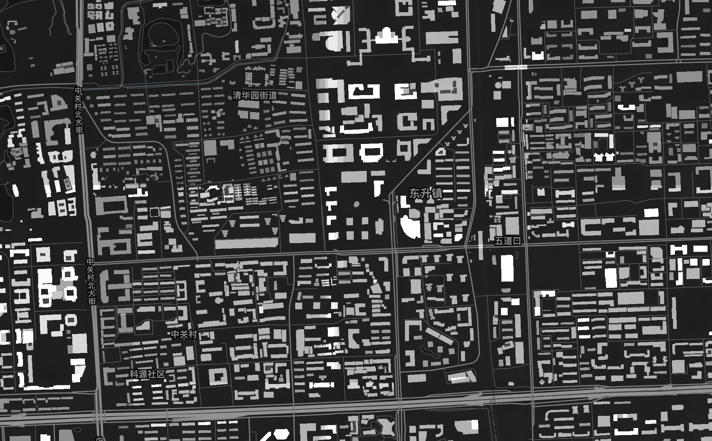
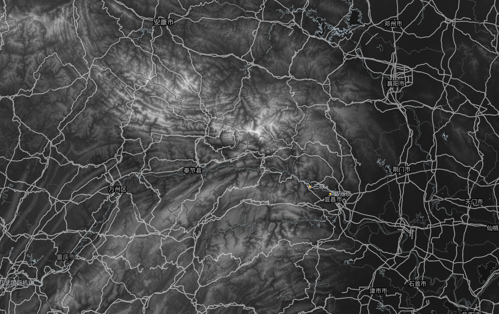

# ReplayMod Reality

> 如果你是以下任何一类人群，你可能会需要这个应用：
> footprint(一生足迹) 用户，google earth 用户，摩友，自行车爱好者，尼康佬，广义驴友，钓鱼佬，自驾游规划者，货车司机，运动相机使用者，铁路迷，飞友，城市探索者。

用于查看个人足迹、编辑地图地标与路线，以及制作轨迹叠加视频的桌面应用。位置 CSV、照片位置和 DJI 视频可以放在同一工作区，通过地图与时间轴定位和处理。

## ReplayMod Reality 可以帮你干什么

提供超酷的 GTAV style 地图，如果你的屏幕支持 HDR，它会更酷。（后面估计会开放一个渲染接口，如果有别人有兴趣实现他们喜欢的美术风格的话）

 

更好地查看你的 footprint 数据 (或者你把其他记录软件的数据整理成我们的格式，或者你可以自己实现一个 converter，合并到项目里来，或者提 issue 我来适配)

处理运动相机的视频：目前可以根据轨迹数据还原一个 GPS 记录，帮你生成类似游戏 UI 的仪表盘；可以在长途旅行中，帮你快进无聊的大直道，利用陀螺仪数据在你有动作的时候放慢回来，也可以在你说话的时候放慢，不说话的时候快进。

更好用的 Google Earth，你可以无痛将你的 Google Earth 数据转化为我们的数据，你的个人地点和路线都会被保存。（后面应该会实现数据导出到 Google Earth）

## 技术栈与实现原理

ReplayMod Reality 基于 [Electron](https://www.electronjs.org/)、[React](https://react.dev/) 和 [TypeScript](https://www.typescriptlang.org/) 开发。Electron 主进程负责本地文件读写、数据解析和媒体任务，React 负责地图工作区与时间轴等界面交互，开发构建和应用打包使用 [Vite](https://vite.dev/) 与 [Electron Forge](https://www.electronforge.io/)。

地图由 [MapLibre GL JS](https://maplibre.org/) 渲染，[MapTiler](https://www.maptiler.com/) 提供在线底图与高程数据。位置 CSV 通过 [csv-parse](https://csv.js.org/parse/) 流式读取，经过坐标校验和时间排序后，同步显示在地图与时间轴上。选择时间时，应用通过相邻采样点插值计算当前位置；选定时间范围后，可以导出带透明通道的轨迹叠加视频，用于后期剪辑。地标与路线以 JSON 工程保存，通过 KML 与其他地图软件交换，KML 的 XML 解析使用 [@xmldom/xmldom](https://github.com/xmldom/xmldom)。

媒体处理基于 [FFmpeg / FFprobe](https://ffmpeg.org/) 和 [GPAC MP4Box](https://gpac.io/)。FFprobe 读取视频与音频轨道信息，FFmpeg 负责视频编码、音频处理和动态变速；保留 DJI 私有遥测轨的压缩流程由 MP4Box 完成轨道替换与封装。字幕识别使用本地运行的 [whisper.cpp](https://github.com/ggml-org/whisper.cpp)，识别结果可以在应用中编辑并保存。

## 安装与启动

需要 Node.js **20.19+ 或 22.12+**、npm，以及用于在线地图的 MapTiler API Key。支持 macOS、Windows 和 Linux 的源码启动入口。

在项目根目录运行：

```bash
npm --prefix source ci
npm --prefix source start
```

Windows 如果 PowerShell 阻止执行 npm 脚本，可将 `npm` 换成 `npm.cmd`。

也可以使用根目录启动脚本，它们会在首次启动或缺少依赖时自动执行 `npm ci`，需要联网：

| 系统 | 入口 |
| --- | --- |
| macOS | 双击 `Start-macOS.command` |
| Windows | 双击 `Start-Windows.cmd` |
| Linux | 执行 `./Start-Linux.sh` |

启动后保持终端窗口打开。首次进入应用时输入 MapTiler API Key，配置会保存到本机，所有启动方式共用。macOS 当前原生窗口背景模块还需要 Xcode Command Line Tools 与 Node.js C headers。

macOS 可双击 `Install-MacOS.command`，打包并安装到 `~/Applications/ReplayMod Reality.app`；更新前退出旧版。其他打包方式、本地工具链与启动排错见 [安装与开发](docs/development.md)。视频与字幕工具按需准备，见 [媒体处理](docs/media.md)。

## 操作方法

### 查看足迹

1. 点击左侧「载入数据源」选择 CSV。源码工作区启动时也会尝试自动读取 `RawData/footprint/` 中最近修改的主 CSV，并合并同目录 PhotoData。
2. 地图自动缩放到数据范围。浅绿色点表示足迹，亮黄色点表示照片位置。
3. 按住 **W / A / S / D** 平移地图。macOS 上鼠标滚轮缩放，触控板双指滑动平移、捏合缩放；Windows 与 Linux 在原生输入后端完成前保留通用滚动后备行为。地图鼠标拖动已禁用。
4. 点击或拖动下方时间轴设置当前时间；红点显示插值后的位置。点击地图数据点，可将时间轴定位到该点。
5. **Ctrl + 滚轮** 缩放时间轴，按住 **Q / E** 平移时间窗口。

CSV 必须提供时间和坐标；字段、时间单位及坐标系说明见 [位置数据格式](docs/data-format.md)。

### 编辑「我的地图」

1. 在左侧「我的地图」导入 KML 或 JSON 工程。导入会替换当前标注，需要保留时先导出项目。
2. 点击顶部「标点」后点击地图添加地标；「画路线」后逐点点击，**Enter** 完成，**Esc** 取消，也可「撤回一点」。
3. 在左侧修改名称、描述、分组、可见性和样式。地标与不超过 200 个顶点的路线支持拖动坐标手柄。
4. 等待自动保存状态完成，或导出 JSON 工程 / KML。删除分组会同时删除其后代。

完整操作和交换范围见 [地图标注](docs/map-annotations.md)。

### 导出轨迹叠加视频

1. 在时间轴定位开始与结束时间，点击「设为入点 (I)」「设为出点 (O)」。
2. 打开「导出设置」，选择分辨率、帧率、码率、分段时长，并选择统计信息与轨迹小地图。
3. 导出带 Alpha 通道的 **VP9 WebM**，在剪辑软件中叠加到原视频。输出时间与轨迹时间保持 **1:1**。

### DJI 视频与字幕

点击「载入 DJI 视频」选择 MP4 / MOV，查看媒体轨道信息；通过「时间压缩 → 谈话类 · 字幕轨」生成、编辑并保存字幕。自动识别需要本地 whisper.cpp 与模型。

媒体底层已有压缩和动态变速逻辑，完整参数化任务界面尚未接入，不能把侧栏的占位入口当作完整编辑器。工具准备、轨道保留与输出限制见 [媒体处理](docs/media.md)。

## 支持的 Features

| 功能 | 当前支持范围 |
| --- | --- |
| 位置数据 | 流式读取 CSV、坐标校验、时间排序、照片位置去重合并、海拔字段 |
| 时间轴 | 自适应时间刻度、缩放与平移、点选定位、当前位置插值、入出点 |
| 地图标注 | 多级分组、点与路线编辑、自动保存、JSON / KML 导入导出、地名聚合 |
| 透明视频 | VP9 WebM + Alpha；720p / 1080p / 4K；24 / 30 / 60 fps；时间、速度、海拔、坡度与小地图 |
| 视频与字幕 | MP4 / MOV 探测、本地语音识别、字幕编辑及 JSON / SRT 保存 |
| 媒体模块 | 编码器探测、FFmpeg + MP4Box 压缩、DJI 姿态倍率分析、动态变速输出；界面仍待完善 |
| 本地恢复 | 地图资源缓存、轨迹快照、工作区与字幕草稿恢复，配置与缓存分开存储 |

当前不自动识别或转换 WGS84 / GCJ-02，不提供 GPX / FIT 导出，也没有完整的轨迹清洗、抽稀与通用 Pass 编辑界面。KML 仅支持已映射的分组、点、路线和颜色；不支持多边形、KMZ 等全部 Google Earth 功能。

更多文档：

- [更新日志与想法](docs/todo_and_done.md)
- [安装、开发与排错](docs/development.md)
- [位置数据格式](docs/data-format.md)
- [地图标注操作与标准](docs/map-annotations.md)
- [媒体处理与外部工具](docs/media.md)
- [本地存储、缓存与恢复](docs/storage.md)
